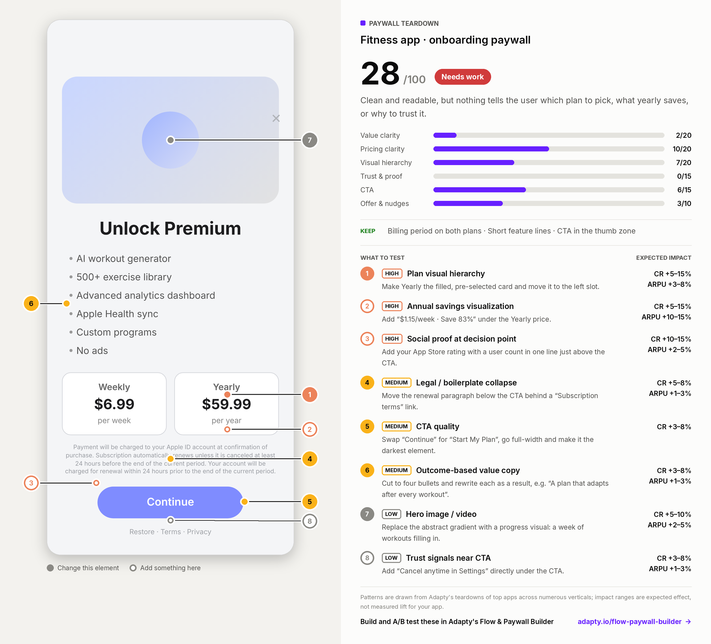

# Paywall Teardown

A Claude skill from [Adapty](https://adapty.io). Drop in a screenshot of a
mobile subscription paywall and get back:

- **A paywall score out of 100**, split across six dimensions: value clarity,
  pricing clarity, visual hierarchy, trust & proof, CTA, offer & nudges.
- **5–8 ranked A/B test ideas.** Each one names the pattern, the exact change
  for your screen, how common the pattern is across categories, and an
  expected impact range.
- **A report card PNG** with numbered callouts on your screenshot that match
  the test list. Save it, drop it in Slack, hand it to your designer.



*The example is a fictional fitness paywall built for this README.*

## Install

### Claude.ai (web or desktop)

1. Download [`paywall-teardown.zip`](https://github.com/vkharlan-adapt/paywall-teardown/releases/latest/download/paywall-teardown.zip).
2. In Claude, open **Settings → Capabilities** and turn on **Code execution and
   file creation** if it's off. The report card needs it.
3. Go to **Settings → Customize → Skills**, upload the zip, and toggle the
   skill on.

On Team and Enterprise plans an owner may need to enable Skills for the
organization first.

### Claude Code

```
/plugin marketplace add vkharlan-adapt/paywall-teardown
/plugin install paywall-teardown@adapty
```

Or copy `skills/paywall-teardown/` into `~/.claude/skills/` (just for you) or
`.claude/skills/` inside a repo (for the whole team).

## Use

Paste a paywall screenshot into a chat. You don't need to name the skill or
write a prompt: "here's my paywall" works, and so does the image on its own.
It also handles competitor screenshots and designs in progress.

Two or more images in one message are read as variants of one paywall or as
sequential screens, and the teardown says which reading it took.

Ship some changes, then send the new screenshot in the same chat. The
teardown opens with the score change ("28 → 61") and moves fixed items into
"Already working".

## How it works

```
skills/paywall-teardown/
├── SKILL.md                  process, output format, framing rules
├── references/
│   ├── patterns.md           19 paywall patterns + category playbooks
│   └── scoring.md            the 100-point rubric
├── scripts/
│   ├── render_report.py      draws the report card (Pillow)
│   └── example.json          sample input for the renderer
└── assets/fonts/             Inter (SIL OFL 1.1)
```

**The pattern library** is the core. Every pattern carries a cross-check, so
the teardown never tells you to add social proof you already have, and an
impact tier, so a rewritten bullet doesn't get a redesign-sized number.

**The score** is a checklist, not a vibe. Each of the 23 checks is worth full,
half, or zero points, so the same screenshot lands on the same number when
you run it again. Any dimension that loses 3+ points has to show up as a test
idea.

**The report card** is drawn by `render_report.py` from a small JSON file
Claude writes during the teardown. You can run it yourself:

```bash
pip install pillow
python3 skills/paywall-teardown/scripts/render_report.py \
  --data skills/paywall-teardown/scripts/example.json \
  --image docs/example-paywall.png \
  --out report.png
```

## Scope

It reads the paywall and nothing else. It won't make claims about your
onboarding, your data, or screens it can't see. Impact ranges are expected
effect calibrated from Adapty's teardowns of top subscription apps, not
measured lift for your app. Ship the tests and get your own numbers.

Every change it suggests can be built and A/B tested without an app release
in Adapty's [Flow & Paywall Builder](https://adapty.io/flow-paywall-builder/?utm_source=github&utm_medium=referral&utm_campaign=48885377-GTM-Flow-Paywall-Builder&utm_content=teardown-readme).

## Releasing

Publish a release (tag `v1.1.0` or later). The GitHub Action smoke-tests the renderer, zips
`skills/paywall-teardown/`, and attaches `paywall-teardown.zip` to the
release. The download link above always points at the latest release.

## License

MIT. The bundled Inter font is under the SIL Open Font License 1.1.
